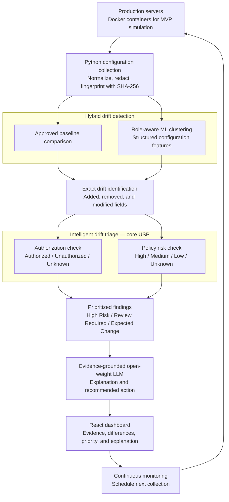

# PS08 — AI-Assisted Configuration Drift Detector

## Purpose

PS08 detects configuration changes across production servers, distinguishes legitimate variation from potentially harmful drift, and gives operators prioritized findings with evidence-grounded explanations.

The core differentiator is **intelligent drift triage**: authorization and policy risk are evaluated independently. An approved change can still be dangerous, and missing approval evidence does not prove that a change was unauthorized.

This document defines the target architecture and a practical MVP. It is a design specification, not a claim that the system is already implemented or production-ready.

## 1. Finalized pipeline

**Production servers → Python configuration collection and SHA-256 fingerprinting → hybrid drift detection (approved baselines plus role-aware ML clustering) → exact drift identification → intelligent drift triage (separate authorization and policy risk checks) → prioritized findings → evidence-grounded open-weight LLM → React dashboard → continuous monitoring.**



The arrows describe the logical workflow. A backend scheduler drives monitoring independently of whether the dashboard is open. Findings are persisted before LLM generation; an unavailable model must not block detection or access to findings.

## 2. Stack and deployment boundaries

| Component | Technology | Responsibility |
|---|---|---|
| Server simulation | Docker | Run reproducible server roles and inject controlled configuration changes. |
| Collection and processing | Python | Collect allowlisted settings, normalize values, redact sensitive content, compute hashes, and orchestrate detection. |
| Peer analysis | scikit-learn | Encode configuration features and cluster comparable servers within role and environment cohorts. |
| API | FastAPI | Serve findings and evidence; manage baseline approvals, change records, and scan requests with access controls. |
| Persistence | PostgreSQL | Store assets, snapshots, baseline versions, approval evidence, policy evaluations, findings, and audit events. |
| Explanation service | Open-weight LLM | Generate structured explanations from a restricted evidence packet; for example, a suitable Llama or Mistral model. |
| User interface | React | Show prioritized findings, exact differences, authorization evidence, policy results, and model explanations. |

For the MVP, use Docker Compose for the simulated servers, FastAPI service, background Python worker, PostgreSQL, React application, and a locally hosted model endpoint. Keep collection and scheduled processing in the worker so API restarts or multiple API processes do not create duplicate schedules.

Production deployment adds authenticated collectors or read-only remote access, encrypted transport, access controls, retention policies, and operational monitoring. Do not grant a web application unrestricted Docker socket access to collect configuration.

## 3. Component responsibilities

### Configuration collector

- Identify each server by stable asset ID, role, environment, and applicable software version.
- Read an explicit allowlist of configuration sources using read-only permissions.
- Parse structured values, standardize types and units, sort object keys, and preserve list order unless the schema declares the list unordered.
- Exclude volatile fields such as timestamps from configuration comparison through versioned rules.
- Remove secrets before storage or downstream processing. Record secret presence or a reference version when necessary, never the secret value or an unsalted hash of a low-entropy secret.
- Compute SHA-256 over canonical JSON containing the normalization version and sanitized configuration.
- Record collection time, source coverage, parser errors, and completeness. Failed reads must not appear as deleted settings.

Hashes establish exact equality of the monitored, sanitized configuration. They do not establish semantic similarity, authenticity, or the absence of changes in excluded fields. Never use SHA-256 strings, bits, or numeric representations as ML similarity inputs.

### Hybrid drift detector

**Approved baseline comparison:** Select an explicitly approved, versioned baseline matching the asset's role, environment, and compatibility scope. Compare the snapshot fingerprint and normalized values with that baseline. A mismatch is a candidate for exact diffing. A missing or incompatible baseline is a coverage gap requiring review, not evidence that the server is compliant.

**Role-aware clustering:** Construct interpretable features from sanitized settings, such as boolean security flags, encoded protocol modes, and scaled timeout values. Fit a versioned preprocessing pipeline and clustering model separately for comparable role/environment cohorts. For the MVP, use DBSCAN with documented feature selection and distance settings; treat noise points as peer anomalies rather than automatically malicious servers.

Exclude asset identifiers, timestamps, secrets, and hashes from features. Do not compare unrelated roles or environments. Set a minimum cohort size and report `insufficient_data` when the cohort is too small. Store model version, cohort, feature schema, and anomaly evidence with each result.

The baseline and ML signals are independent. Peer similarity must never override a baseline mismatch or a policy violation. If most servers acquire the same incorrect setting, baseline comparison must still detect it. No cluster, majority configuration, or historical observation becomes an approved baseline automatically.

### Exact drift identifier

Produce field-level differences with configuration path, operation (`add`, `remove`, or `replace`), previous value, current value, and reference identity.

Use the approved baseline as the authoritative comparison when available. For a peer-only anomaly, compare against a clearly labeled representative peer and report differing features as **peer deviations**, not approved-baseline violations. A previous snapshot can provide change history but is not an approved baseline.

Attach source coverage and evidence IDs to each difference. Distinguish an absent field from an explicit `null`. Only report removals when the relevant source was collected successfully.

### Intelligent drift triage

Run two independent evaluations:

1. **Authorization:** Match trusted change records against asset scope, configuration paths, intended values, execution window, and approval status.
2. **Policy risk:** Evaluate current configuration against versioned deterministic policies, independently of approval status and ML output.

An authorization result is:

- `authorized`: a trusted approval matches the observed change and scope.
- `unauthorized`: affirmative trusted evidence establishes that this specific change was rejected, prohibited, or performed without permission.
- `unknown`: approval evidence is missing, ambiguous, stale, inaccessible, or insufficiently specific.

A change outside a known approval's scope does not inherit that approval. Without affirmative contrary evidence, classify its authorization as `unknown`.

Policies return `high`, `medium`, `low`, or `unknown` risk with rule IDs and supporting evidence. Unknown means evaluation was incomplete or required inputs were unavailable; it must not silently become low risk. Evaluate relevant security policies even when a fingerprint is unchanged so unsafe approved baselines remain detectable.

### Evidence-grounded explanation service

Provide the model only an allowlisted evidence packet: sanitized differences, baseline reference, authorization result and evidence IDs, policy results, ML signal, and the already assigned priority.

Require structured output containing a summary, why the change matters, recommended operator actions, evidence references, and limitations. Validate the output schema and reject references to evidence that was not supplied. Clearly label generated explanations and use a deterministic template if generation fails or is unsupported.

The model must not assign or modify priority, approve changes, execute commands, remediate servers, or promote baselines. Treat configuration text as untrusted data, including text that resembles instructions. Disable tools and external retrieval for the MVP explanation step. Use a controlled model endpoint and redact logs and prompts; **no secrets go to the LLM**.

### API, dashboard, and monitoring

FastAPI exposes filtered findings and supporting evidence. React shows priority first, followed by exact differences, authorization status, risk rules, peer signals, explanation status, and collection freshness.

Operators can acknowledge or resolve findings and explicitly approve new baseline versions according to their permissions. Acknowledgment and resolution do not approve a configuration. Every state transition is audited.

The worker schedules scans, retries transient failures with bounded backoff, and records failed or stale collection separately. Deduplicate unchanged findings while updating `last_seen`; preserve recurrence and resolution history. Monitoring continues regardless of LLM or dashboard availability.

## 4. Data flow and persistence

1. Load asset inventory, source allowlists, approved baselines, policy versions, and trusted change records.
2. Collect and normalize settings; persist a sanitized snapshot with fingerprint and coverage metadata.
3. Run baseline comparison and role-aware peer analysis. Persist both signals, including missing-data conditions.
4. Calculate exact differences and identify the reference used for each difference.
5. Evaluate authorization and policy risk independently. Aggregate results conservatively: mixed approval coverage is not fully authorized, and the highest applicable known risk takes precedence.
6. Assign a deterministic classification and persist the finding and its evidence atomically.
7. Submit the sanitized evidence packet for explanation; update its status to `ready`, `failed`, or `template_fallback`.
8. Serve results to React through FastAPI; record operator actions in the audit trail.
9. Repeat on schedule. Reuse unchanged sanitized snapshots where useful, but re-evaluate when policies, baselines, approvals, or peer models change.

### Minimum logical schemas

Use UUID primary keys, UTC timestamps, foreign keys, and constrained status values. JSONB is suitable for normalized configuration and evidence payloads; frequently filtered fields should remain ordinary indexed columns.

| Entity | Essential fields |
|---|---|
| `assets` | `id`, `name`, `role`, `environment`, `compatibility_scope`, `last_seen_at` |
| `snapshots` | `id`, `asset_id`, `collected_at`, `normalization_version`, `config_json`, `sha256`, `coverage_json`, `collection_status` |
| `baselines` | `id`, `version`, `role`, `environment`, `compatibility_scope`, `config_json`, `sha256`, `normalization_version`, `approved_by`, `approved_at`, `status` |
| `change_records` | `id`, `source`, `external_id`, `asset_scope`, `allowed_changes_json`, `valid_from`, `valid_until`, `status`, `evidence_ref` |
| `policy_versions` | `id`, `rule_id`, `version`, `scope_json`, `predicate_json`, `severity`, `enabled` |
| `model_runs` | `id`, `model_version`, `feature_schema_version`, `cohort_json`, `snapshot_ids`, `result_json` |
| `findings` | `id`, `asset_id`, `snapshot_id`, `baseline_id`, `model_run_id`, `classification`, `authorization`, `risk`, `status`, `first_seen`, `last_seen`, `dedup_key` |
| `finding_evidence` | `id`, `finding_id`, `type`, `reference_id`, `payload_json` |
| `explanations` | `id`, `finding_id`, `evidence_packet_hash`, `model_version`, `prompt_version`, `status`, `output_json` |
| `audit_events` | `id`, `actor`, `action`, `entity_type`, `entity_id`, `timestamp`, `details_json` |

Keep approved baseline versions immutable; replacement requires a new explicit approval. Preserve the policy and evidence versions needed to reproduce a finding. Make scan ingestion idempotent and index findings by classification, status, asset, and last-seen time.

### Example finding contract

The identifiers below are illustrative aliases; stored identifiers use UUIDs.

```json
{
  "finding_id": "finding-1042",
  "asset_id": "web-prod-03",
  "role": "web",
  "environment": "production",
  "snapshot_id": "snapshot-88",
  "baseline": {"id": "baseline-web", "version": 3},
  "detection": {
    "baseline_mismatch": true,
    "peer_status": "in_cluster",
    "model_version": "web-prod-v2"
  },
  "differences": [
    {
      "evidence_id": "diff-1",
      "path": "ssh.permit_root_login",
      "operation": "replace",
      "before": false,
      "after": true,
      "reference_type": "approved_baseline"
    }
  ],
  "authorization": {
    "status": "authorized",
    "evidence_ids": ["change-441"]
  },
  "policy": {
    "risk": "high",
    "complete": true,
    "violations": [
      {"rule_id": "SSH-001", "version": 1, "evidence_ids": ["diff-1"]}
    ]
  },
  "classification": "high_risk",
  "status": "open",
  "explanation_status": "pending"
}
```

The example intentionally shows an authorized change receiving high priority because it violates a high-risk policy.

## 5. Classification decision logic

Apply rules in order. Authorization never lowers policy risk. ML anomalies trigger investigation but do not independently prove high security risk.

| Condition | Classification | Reason |
|---|---|---|
| Any applicable high-risk policy violation | **High Risk** | Approval and peer agreement cannot suppress a serious violation. |
| No high-risk violation, but evidence or required evaluation is incomplete | **Review Required** | Missing baseline, partial collection, unknown policy risk, or unavailable required peer analysis needs investigation. |
| Medium policy risk | **Review Required** | A policy concern requires operator assessment. |
| Authorization is unknown or unauthorized | **Review Required** | The change needs investigation; security severity still comes from policy evidence. |
| Unexplained peer anomaly | **Review Required** | An unusual configuration needs explanation even when approved. |
| Fully authorized change, low policy risk, complete evidence, no unexplained peer anomaly | **Expected Change** | The observed variation matches approval and passes required risk evaluation. |

```python
def classify(result):
    if result.has_high_risk_violation:
        return "high_risk"
    if not result.required_evidence_complete or result.policy_risk == "unknown":
        return "review_required"
    if result.policy_risk == "medium":
        return "review_required"
    if result.authorization != "authorized":
        return "review_required"
    if result.unexplained_peer_anomaly:
        return "review_required"
    return "expected_change"
```

Run classification for detected changes, policy violations, peer anomalies, or coverage gaps. A complete scan with no drift, no anomaly, and passing policies creates a healthy scan record rather than an artificial expected-change finding.

Peer analysis can be explicitly marked optional for a small cohort by a versioned deployment rule. Otherwise, insufficient peer data prevents automatic expected-change classification. Display all unknown statuses regardless of this choice.

Within each classification, sort deterministically using policy severity, asset criticality, affected asset count, and finding age. Expose the reasons; avoid an unexplained aggregate “AI risk score.”

## 6. Safeguards and failure behavior

- **Baseline integrity:** Only designated approvers can activate a baseline. Majority behavior never constitutes approval.
- **Comparison integrity:** Baseline and snapshot normalization versions must match or undergo an explicit migration. A collector error is not a configuration deletion.
- **Secret protection:** Redact before persistence, feature extraction, model prompts, and logging. Test nested fields and free-text configuration values. The MVP does not detect changes inside excluded secret values.
- **Authorization integrity:** Use trusted approval sources; configuration comments and model output are not approval evidence. Missing approval means unknown.
- **Evidence integrity:** Preserve snapshot, policy, model, approval, and baseline references. A hash detects content equality; authenticate collectors separately.
- **Model containment:** The LLM explains existing evidence. Reject malformed or unsupported output and retain the deterministic finding.
- **Operational resilience:** Collection failures, stale assets, database failures, and LLM failures are visible. Never mark a failed scan as healthy; use bounded retries and idempotent writes.
- **Access control:** Separate viewer, operator, and baseline-approver permissions. Audit approvals, policy changes, and finding state changes.
- **Human control:** No automatic remediation, baseline promotion, or infrastructure changes in the MVP.

## 7. MVP scope

Build a demonstrable end-to-end system using approximately 12 Docker containers split into web and worker roles, with cohort-size requirements set explicitly for the demonstration.

Include:

- Structured JSON/YAML configuration collection for a small allowlist of settings: root login, TLS mode, logging, exposed ports, and service timeouts.
- Approved role/environment baselines with version history and explicit approval.
- SHA-256 equality checks, field-level differences, and role-aware scikit-learn clustering.
- A small versioned policy set and manually entered or imported trusted change records.
- Three finding classifications with separate authorization and policy-risk fields.
- PostgreSQL persistence, FastAPI endpoints, a background scan worker, a React findings dashboard, and a controlled open-weight LLM endpoint.
- A configurable scan interval, initially 60 seconds in the demonstration, with stale-collection reporting.

Defer automatic remediation, automatic baseline learning, enterprise approval-system integrations, large-scale distributed collection, unrestricted file discovery, and LLM agents with execution capabilities.

Suggested API surface: `GET /assets`, `POST /scans`, `GET /scans/{id}`, `GET /findings`, `GET /findings/{id}`, `PATCH /findings/{id}`, `POST /change-records`, `POST /baselines`, and `POST /baselines/{id}/approve`. Mutation endpoints require appropriate permissions and audit records.

## 8. MVP validation and acceptance criteria

Use labeled, repeatable drift injections. Calibrate clustering on separate fixtures from the final evaluation set. Report counts and confusion matrices instead of claiming general accuracy from a small demonstration.

| Scenario | Required outcome |
|---|---|
| Canonical configuration reordered without semantic change | Same fingerprint; no spurious field differences. |
| One monitored field added, removed, or modified | Exact path, operation, old/new values, and comparison reference are correct. |
| Approved low-risk timeout change | Expected Change when required evidence is complete and there is no unexplained anomaly. |
| Approved high-risk root-login change | High Risk despite authorization. |
| No matching approval record | Authorization is unknown, never automatically unauthorized. |
| Explicit rejection linked to the observed change | Authorization is unauthorized; classification reflects independent policy risk. |
| Most servers receive the same incorrect configuration | Every affected asset is detected against its approved baseline, even if ML considers the majority normal. |
| Legitimate differences between web and worker roles | No anomaly caused solely by mixing roles. |
| Outlier within a sufficiently large role cohort | Peer signal and differing features are visible; unexplained deviation requires review. |
| Missing baseline, parser failure, or incomplete collection | Coverage gap is visible; no false healthy result or false deletion. |
| Unsafe setting already present in an approved baseline | Policy evaluation still produces the appropriate violation. |
| Secret-bearing or instruction-like configuration input | No secret reaches storage, logs, or prompts; embedded instructions cannot alter priority or trigger actions. |
| LLM unavailable or returns unsupported evidence references | Finding remains accessible with pending, failed, or template-fallback explanation status. |
| Identical repeated scan | Existing finding updates without duplicate open findings. |
| Policy, approval, or baseline changes while configuration stays unchanged | Relevant findings are re-evaluated. |

MVP acceptance gates:

1. All deterministic fixtures above pass, including 100% detection of injected high-risk baseline deviations in the test suite.
2. Every finding exposes reproducible evidence and independent authorization and risk decisions.
3. Every displayed model explanation references only supplied evidence; invalid outputs are rejected or replaced with a template.
4. Seeded secret canaries appear nowhere in stored snapshots, feature payloads, logs, or model requests.
5. On declared demo hardware and the stated asset count, 95% of injected changes become visible as findings within two scan intervals. Measure LLM latency separately.
6. Clustering precision and recall are reported on held-out labeled scenarios, with cohort sizes and limitations. Thresholds are documented before evaluation; ML results cannot suppress deterministic violations.
7. Monitoring survives an API restart without duplicate scheduling, and model downtime does not interrupt collection or triage.

The MVP succeeds when operators can see exactly what changed, whether approval is established, which policy risk applies, and why the system assigned its priority—with every explanation traceable to recorded evidence.
